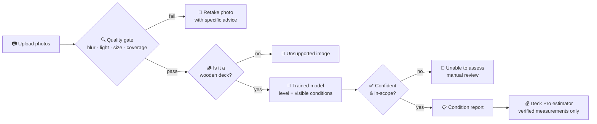

<div align="center">

# 🪵 Deck Pro: AI Deck Condition Analysis System

**Upload a deck photo. Check it is clear enough. Get an honest, explainable condition report.**


[📄 Full Problem Statement (PDF)](docs/Deck_Pro_Problem_Statement_v2.pdf) · [🧭 Workflow](#-how-it-works) · [🗺️ Roadmap](#-roadmap)

</div>

---

## 💡 The idea in one minute

Wooden decks wear out from sun, rain and use. Before a restoration quote, someone must judge the deck's condition from photos, and that judgement is slow and varies between people.

**Deck Pro** automates the *first look*:

1. A user uploads deck photos.
2. The system **checks the photo is clear enough to judge**.
3. A trained image model predicts the **visible condition** with a **calibrated confidence**.
4. If the photo is poor or the model is unsure, it says so. It asks for a better photo or sends the case to a human.

> It supports the existing estimator. It does **not** replace professional inspection, judge structural safety, or set prices.

---

## 🧭 How it works



---

## 📖 Problem statement, step by step

Click each step to expand. The complete version is in the [PDF](docs/Deck_Pro_Problem_Statement_v2.pdf).

<details>
<summary><b>Step 1 · What is the problem?</b></summary>

<br>

- Deck condition is judged manually from photos.
- It is time-consuming, and two reviewers can disagree (for example "mild" versus "moderate").
- Sending every photo to an expensive LLM or vision API adds per-image cost and gives no consistent, controlled output.

**Goal:** a consistent, scalable, cost-conscious first-level visual assessment tool.

</details>

<details>
<summary><b>Step 2 · What must the system do?</b></summary>

<br>

| # | Requirement |
|---|-------------|
| 1 | Classify the **overall visible condition** into 5 levels |
| 2 | Detect **specific visible conditions** (fading, peeling, cracks, dark staining) |
| 3 | **Check image clarity** before predicting anything |
| 4 | Return **calibrated confidence** and an uncertainty flag |
| 5 | Produce a **structured report** from expert-approved text, not model-written advice |
| 6 | Keep every result traceable to a **model version** and an estimate |

</details>

<details>
<summary><b>Step 3 · Image clarity: the minimum quality bar</b></summary>

<br>

A model cannot judge fine fading or early cracks from a blurry or tiny photo. So a **quality gate runs first**, and the same gate filters training data.

| Check | Protects against | Starting approach |
|-------|------------------|-------------------|
| Resolution | Detail too small | Shorter side at least 1000 px; reject below 640 px |
| Sharpness | Motion blur, missed focus | Variance of Laplacian on the deck area |
| Exposure | Too dark or washed out | Histogram clipping check |
| Glare / shadow | Hidden surface texture | Detect saturated patches and harsh stripes |
| Deck coverage | Mostly sky, house or lawn | Deck boards fill at least about 30% of a full view |
| Angle | Extreme grazing view | Board-line perspective estimate |
| Occlusion | Furniture, leaves, snow | Detect non-deck objects over the surface |

> ⚠️ These thresholds are **starting values**. Tune them against human reviewers' "readable / not readable" judgements on real photos.

**Outcomes:** ✅ pass · ⚠️ pass with warning · ❌ fail, with a specific retake tip.

</details>

<details>
<summary><b>Step 4 · What categories does the model learn?</b></summary>

<br>

**A. Overall visible condition (one label, ordered)**

| Level | Label | Meaning |
|:----:|-------|---------|
| 1 | Good condition | Relatively intact, minimal deterioration |
| 2 | Mild wear | Minor fading or limited coating wear |
| 3 | Moderate deterioration | Noticeable fading, localised peeling |
| 4 | Severe deterioration | Extensive peeling or coating loss |
| 5 | Significant visible wood damage | Prominent cracks or splintering |

**B. Visible conditions (zero or more):** fading or discoloration · peeling or flaking coating · cracks or splintering · dark staining (cause not confirmed) · no major deterioration

**C. Image validity:** valid · borderline quality · poor quality · unsupported or irrelevant

> These are **visual** categories, not engineering safety ratings.

</details>

<details>
<summary><b>Step 5 · How is the dataset built?</b></summary>

<br>

**Sources, best first:** restoration contractors → Deck Pro customer uploads (with consent) → public datasets (Kaggle, Roboflow Universe, Hugging Face, academic) → synthetic images as a supplement only.

| Stage | Planning target |
|-------|-----------------|
| Prototype | 100 to 200 images per category |
| Useful training set | 300 to 500 per category |
| Strong coverage | 1,000+ per category |

**Labeling rules**
- Write a labeling guide with reference photos for every level.
- Two reviewers label a sample independently, then measure agreement.
- An expert settles disagreements.

**Splitting:** about 70 / 15 / 15, **grouped by deck** so photos of one deck never appear in both training and test.

</details>

<details>
<summary><b>Step 6 · Which model?</b></summary>

<br>

- **Transfer learning** from a pretrained model: **MobileNetV3** or **EfficientNet** (benchmark both on your data).
- Two heads: an **ordered 5-level** head and a **multi-label** head.
- **Calibrate** confidence, then **reject** when confidence is low, the top two classes are close, or the image looks unlike the training data.
- Serve it through a Python **FastAPI** service. Never retrain per upload.

</details>

<details>
<summary><b>Step 7 · How do we know it is good?</b></summary>

<br>

- Per-class precision, recall and F1, macro-F1, confusion matrix
- Ordered metrics: mean level error, weighted kappa
- Calibration error and a risk-coverage curve
- Accuracy **by image-quality tier**, wood type, lighting and device
- Test on **decks never seen** in training, plus a comparison with human experts

Accuracy targets are agreed with the product owner **after** the pilot, not guessed in advance.

</details>

<details>
<summary><b>Step 8 · What does the output look like?</b></summary>

<br>

```json
{
  "image_id": "DECK-00042",
  "model_version": "deck-condition-v1",
  "status": "completed",
  "image_quality": { "status": "pass", "sharpness_score": 0.78, "deck_coverage": 0.64 },
  "overall_condition": { "level": 3, "label": "Moderate deterioration", "confidence": 0.87 },
  "visible_conditions": [
    { "label": "peeling_coating", "confidence": 0.91 },
    { "label": "fading", "confidence": 0.84 }
  ],
  "limitations": ["Structural safety cannot be determined from this image."],
  "requires_manual_review": false
}
```

*Values are illustrative, not measured performance.*

</details>

<details>
<summary><b>Step 9 · What is out of scope?</b></summary>

<br>

- Structural safety (rot depth, load capacity, fasteners, railings)
- Pricing and area measurement (the approved estimator handles these)
- Diagnosing *why* a dark patch exists (moisture, mould, dirt)
- Conversational LLM explanations (possible later, not in the main workflow)

</details>

<details>
<summary><b>Step 10 · Definition of done for the pilot</b></summary>

<br>

- [x] Problem statement written
- [ ] Labels and labeling guide approved by a restoration expert
- [ ] Image-quality gate validated against human reviewers
- [ ] Model tested on unseen decks, with per-class results
- [ ] Low-confidence cases routed to manual review
- [ ] Reports use approved recommendations and show limitations
- [ ] Predictions traceable to model version and estimate
- [ ] Consent, retention and security controls in place
- [ ] Existing estimator runs independently

</details>

---

## 🏗️ Planned architecture

| Layer | Technology | Role |
|-------|------------|------|
| Frontend | React | Upload with capture tips, results, report history |
| API | Node.js + Express | Auth, roles, validation, estimator integration |
| ML service | Python + FastAPI | Quality gate, inference, calibration, rejection |
| Training | PyTorch or TensorFlow | Fine-tune the pretrained model |
| Data | MongoDB + object storage | Reports and model versions; images in secure storage |

---

## 🗺️ Roadmap

| Phase | Focus | Status |
|:-----:|-------|:------:|
| 0 | Define labels, quality criteria, metrics | 🟡 In progress |
| 1 | Pilot dataset and labeling agreement | ⚪ Planned |
| 2 | Baseline and transfer-learning model | ⚪ Planned |
| 3 | Quality gate, calibration, rejection | ⚪ Planned |
| 4 | FastAPI + Node.js integration, report templates | ⚪ Planned |
| 5 | Controlled pilot with contractors | ⚪ Planned |

---

## 📂 Repository structure

```text
AIDeckConditionAnalysisSystem/
├── README.md
└── docs/
    └── Deck_Pro_Problem_Statement_v2.pdf   ← full problem statement
```

*The structure will grow as development starts (`data/`, `ml_service/`, `backend/`, `frontend/`).*

---

## ⚠️ Disclaimer

This system gives a **visual, first-level assessment only**. It is not a structural inspection and does not replace a qualified professional or the approved pricing formulas.

---

<div align="center">

**Author:** [Ashok Kumar Boya](https://github.com/ashokkumarboya93) · 📄 [Read the full problem statement](docs/Deck_Pro_Problem_Statement_v2.pdf)

</div>
